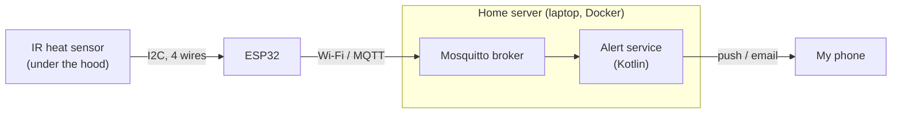
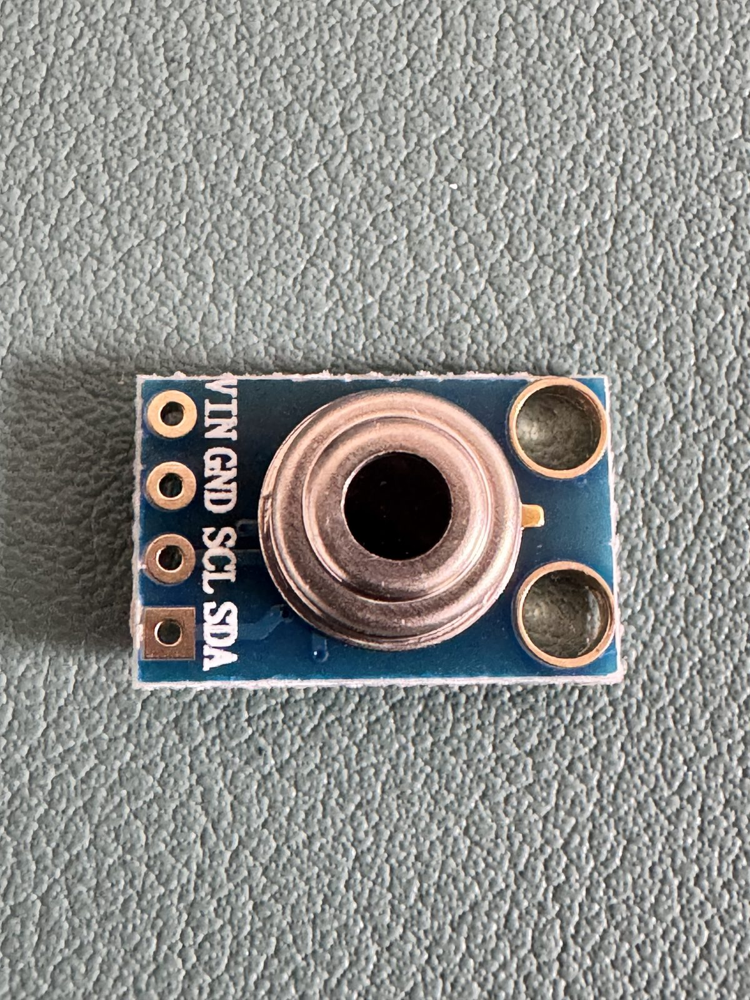
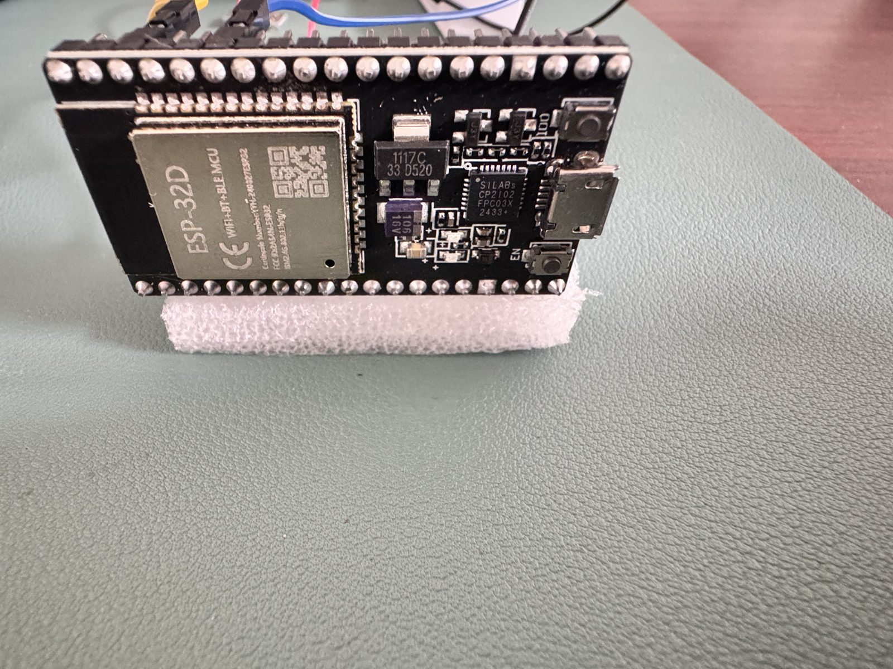
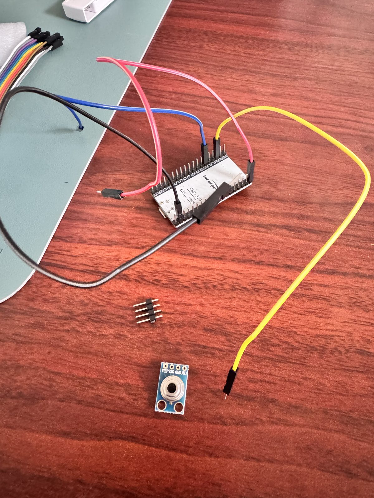
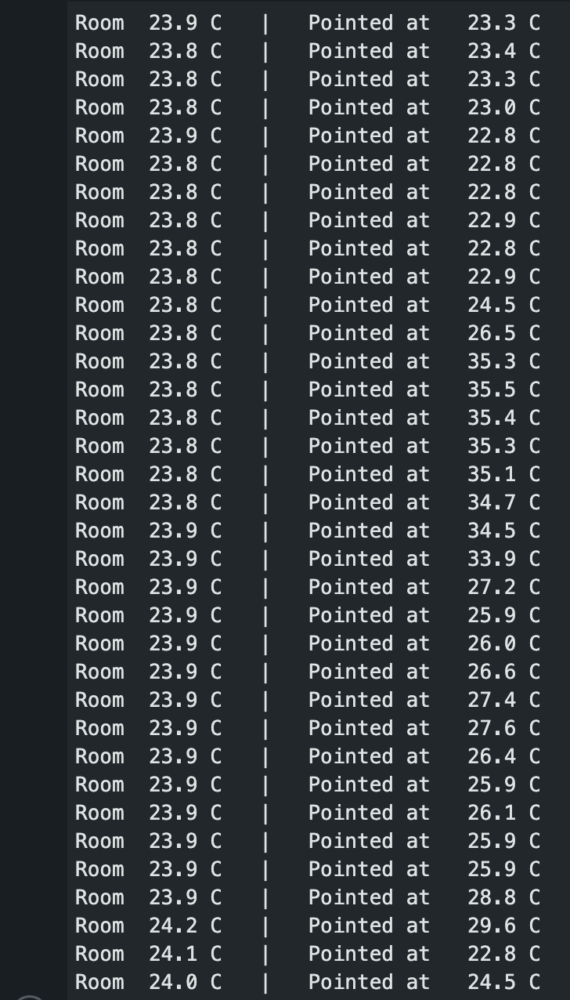

# Stove Monitor

**A sub-$50 device that watches my gas stove and pings my phone if a burner has been left on.**

> 🚧 Work in progress. I'm building this in public. Progress and the build log are below.

---

## Why I'm building this

I keep leaving the stove on.

Mornings with a toddler are hectic, and more than once I've realized too late that a burner was still going. My LG gas stove has Wi-Fi, and its app can *show* me the stove is on, but only if I think to open it. It never actually tells me.

What I want is simple: **if a burner has been on for 15–20 minutes, notify my phone**, whether I'm in the kitchen, the garage, or outside.

And since this approach doesn't touch the stove at all, it should work on **any stove**, including the many that have no Wi-Fi.

## How it works



1. An **infrared temperature sensor** under the range hood measures the cooktop's heat without touching anything.
2. An **ESP32** microcontroller reads it every 5 seconds and sends the reading over Wi-Fi.
3. **Mosquitto**, a message broker running in Docker, receives the readings.
4. An **alert service** decides whether the stove has been on too long, and whether the sensor itself has gone silent.
5. It sends a **notification to my phone**.

## Hardware

| Part | What it does | Approx. cost |
|---|---|---|
| ESP32 dev board (HiLetgo ESP-32S) | Small Wi-Fi computer that reads the sensor | $10 |
| MLX90614 IR temperature sensor | Measures the cooktop's temperature from a distance | $16 |
| Jumper wires | Connect the sensor to the ESP32 (4 wires) | $6 |
| Micro-USB to USB-C data cable | Power and uploading code | $7 or free if you already have one |

**Total: about $35**, plus a laptop (or later, a Raspberry Pi) as the home server.

<p>
  
  
</p>

*Left: the MLX90614 infrared sensor. The four holes are power, ground, and two data lines. Right: the ESP32 board.*

## Key design decisions

- **Non-contact sensing.** An infrared sensor under the hood means no wiring into a gas appliance, and it works on any stove.
- **Cheap sensor first, upgrade if needed.** A $12 single-point sensor before a $60 thermal camera. Real tests at hood height decide whether the upgrade is worth it.
- **Laptop before Raspberry Pi.** Everything runs in Docker, so it moves to a Pi later with no code changes.
- **Software before hardware.** While waiting for parts, I built a fake ESP32 that sends realistic readings, so the backend could be developed and tested first.
- **MQTT for messaging.** It's lightweight and built for small devices. Its "last will" feature lets the system detect when the sensor loses power or Wi-Fi. A silent sensor is a failure worth alerting on too.
- **The right language per layer.** C++ on the ESP32 (it has about 320 KB of memory, far too little for a JVM), and Kotlin for the alert service and Android app.

## Progress

- [x] Message broker (Mosquitto) running in Docker
- [x] Fake ESP32 simulator for testing without hardware
- [x] Sensor wired to the ESP32 and reading temperatures
- [ ] Hood-height test: can the sensor see a pot from ~2 feet?
- [ ] ESP32 sending readings over Wi-Fi
- [ ] Alert service in Kotlin (stove on 15+ min → alert, sensor offline → alert)
- [ ] Push notifications to my phone
- [ ] Mount it under the hood
- [ ] Android app with live status and alert history

## Build log

- **Sep 28:** Started the project. Picked a non-contact infrared sensor, an ESP32, and MQTT. Got Mosquitto running in Docker and built a fake ESP32 to test against.
- **Oct 1:** Parts arrived. Wrote the ESP32 firmware. Learned that the sensor's header pins come unattached, and that a wire near the board's flash-memory pins blocks code uploads.

  

  *First wiring attempt. The jumpers are on the ESP32, but the sensor's header pins (center) still needed attaching.*

- **Oct 8:** First real readings 🎉 Room temperature, then my palm (up to 35.5°C), then my laptop (~26–27°C).

  

  *The sensor's first readings. "Room" is the sensor's own temperature. "Pointed at" jumps when something warm is in front of it.*

## Repository layout

```
stove_monitor/
├── docker-compose.yml        # Mosquitto broker
├── docs/images/              # Build photos
├── mosquitto/config/         # Broker settings
├── simulator/                # Fake ESP32 for testing without hardware
└── firmware/
    ├── sensor_test/          # Checks the sensor wiring, prints temperatures
    └── stove_sensor/         # Real firmware: sends readings over Wi-Fi
```

## Try it

**Start the broker** (needs Docker):

```
docker compose up -d
```

**Watch messages** in one terminal:

```
docker exec -it mosquitto mosquitto_sub -t "home/kitchen/stove/#" -v
```

**Run the fake ESP32** in another (scenarios: `idle`, `cook`, `forgot`, `offline`):

```
docker build -t stove-sim simulator
docker run --rm -e MQTT_HOST=host.docker.internal stove-sim cook
```

**Real hardware:** see [`firmware/README.md`](firmware/README.md) for wiring and uploading. Copy `firmware/stove_sensor/secrets.example.h` to `secrets.h` and fill in your Wi-Fi and server address.

## A note on safety

This is a **reminder tool**, not a safety device. It doesn't replace smoke detectors, carbon monoxide or gas detectors, or paying attention in the kitchen.
